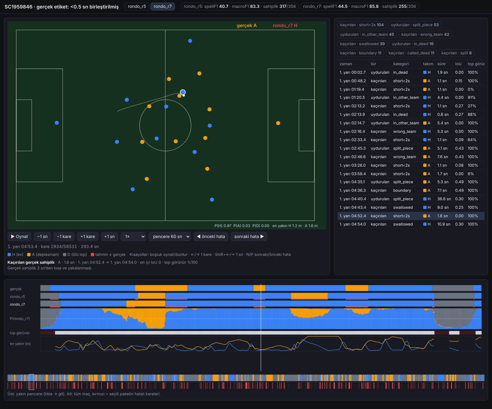

# rondolabs ⚽ — who has the ball?

*More Than a Hack 2027 · Phase 1 · Ball possession*

We are **rondolabs**, three people who love football and data:

- **Can Çelikman**, data scientist
- **Ahmet Can Karaoğlan**, data scientist
- **Alicem Yurtever**, football enthusiast, and the one who keeps asking "but would a referee see it that way?"

We named the team after the *rondo*, the keep-ball drill at the heart of Barça's football: a circle
of players, one ball, and a constant question of who controls it. That question is exactly what
this challenge is about.

---

## The challenge

Metrica Sports, FC Barcelona and the Mobile World Capital gave every team **one full LaLiga match**,
Barcelona vs Athletic Club. It came with the tactical video, automatic tracking of all 22 players
and the ball, and automatic tactical tags. The task sounds simple. For each of the **199,319
video frames**, decide who has the ball:

| label | meaning |
|---|---|
| `H` | Barcelona (home) in possession |
| `A` | Athletic (away) in possession |
| `D` | dead ball: out of play, foul, stoppage |
| `X` | not scored: before kick-off, half-time, after the final whistle |

Entries are ranked by **spellF1**. It scores every *possession* as one unit, not every frame. So a
possession you miss or split costs you, even when most of its frames are right.

## Why it is harder than it looks

- **The ball disappears.** Automatic tracking loses the ball for about 40% of the scored frames,
  often in duels, crowded areas and restarts.
- **Close is not the same as control.** A defender one metre from the ball is not in possession.
  The rules say a loose or contested ball stays with the last team that controlled it. Our error
  analysis showed that **89% of our wrong-team frames happen in these loose or contested moments**.
- **Possessions are short.** Roughly a fifth to a quarter of official possessions last under 2 seconds. One
  touch and a pass can already be a possession.
- **No labels for the game itself.** Everything has to be learned from *other* games, recorded by
  other providers who use slightly different definitions. The public 5 minutes may only be used to
  check that the pipeline works, not to tune it.

## What we built

A model trained only on labelled matches from other games, with every decision made by a rule we
wrote down before we saw the result:

1. **Two learned members**, each a gradient-boosted frame classifier plus a temporal convolutional
   network. They read ball–player geometry and motion, and output H / A / D probabilities and
   "a new possession starts here" signals.
2. **A multi-source correction model**, trained on two different data providers with equal weight.
   It fixes systematic mistakes without overfitting to one provider.
3. **A directed Viterbi decoder** that turns frame probabilities into clean possessions. It switches
   team only when the evidence is strong enough.
4. **A set/graph network over the ball and all 22 players**. Each player is described relative to
   the ball. The players are pooled per team with attention, and the result is read over a ±2 second
   window. In the submitted version it is the average of two such networks that also learned from
   **64 FIFA World Cup 2022 matches from PFF FC**, and its opinion is mixed in half and half.
5. **Kick-off rules** from the official tactical tags.

The full story, including what we tried and dropped, is in the technical document
**[rondolabs.md](rondolabs.md)** (also as `rondolabs.pdf`).

## Looking at our own mistakes

To learn *why* the model fails, we built a small pitch replay for labelled open-data matches. It
shows the players, the ball and its trail, the true possession next to our prediction, the model's
probabilities, and a clickable list of every error, sorted by type.



*Open SkillCorner A-League match, not the competition game. Top: the moment of a missed 1.6-second
possession. Bottom: truth, two model versions, probabilities, ball visibility and nearest-player
distance over one minute. Build your own with `tools/viewer_dump.py` + `tools/viewer_html.py`.*

## Results we trust

Every candidate was judged on labelled matches the model had not seen. Until the last evening we
judged mainly on ten A-League SkillCorner matches; this is how F7, the base of our submission, was
chosen:

| check | F4 | F6 | **F7** |
|---|---:|---:|---:|
| 2 held-out SkillCorner matches (opened once) | 40.1 | 45.3 | |
| 5 SkillCorner matches never used (selection set) | 43.3 | 46.7 | **47.5**, better in 5 of 5 |
| 5 more SkillCorner matches, opened once (test) | 39.8 | 44.0 | **45.6**, better in 5 of 5 |

Two more graph networks trained with different random seeds gained +1.1 and +1.0 over F6 on the same
ten matches, so the gain is not a lucky seed. The graph network helps on noisy, broadcast-style
tracking and costs points on very clean tracking.
The competition tracking is of the first kind. The full trade-off is in the technical document.

**The last evening changed how we choose.** Adding the PFF World Cup data, every new network was
better on all other providers and worse on the A-League set. Watching tracking replays and measuring
every source showed why: each provider sees the game differently, and none looks like the
competition data in every respect. Instead of trusting one league, we wrote
a new rule: score every candidate on five families of labelled matches (SkillCorner, IDSSE, Metrica,
Groningen, held-out PFF), check first which families agree with each other, and decide on those.
Four providers agreed almost perfectly (Spearman +0.87 to +0.92); the A-League set ranked the other
way (−0.80) and was left out. The submitted **F10** gains **+1.95 spellF1 on average** over F7 on the
four (+0.5 IDSSE, +2.0 Metrica, +2.7 Groningen, +2.7 PFF) and gives up 0.7 on the A-League set.

Our lesson: **the experiment design is as decisive as the architecture**, and more, more varied data
gives a model you can trust more.

---

## Reproduce our submission

Requirements: Python 3.13, CPU only, pinned dependencies.

```
python -m venv .venv
.venv\Scripts\python -m pip install -r requirements-tcn.txt
.venv\Scripts\python -m rondo.predict --package models/rondo_r10 --data <organiser data folder> --out rondolabs.csv
.venv\Scripts\python evaluation/validate_submission.py rondolabs.csv
```

Expected output: `rondolabs.csv`, 199,319 rows, SHA-256
`db1f4e975550534bdf16c1f35c47ae127d4e6d37be3d49a3cac3a69d6f21d14f`.

- `<organiser data folder>` is the competition bundle. It contains `tactical/BAR-ATH_tactical_atd.txt`,
  `tactical/BAR-ATH_tactical_atd.xml` and `tactical/BAR-ATH_tactical_smart_tagging.xml`.
- The match data is **not** in this repository.
- On Linux or macOS, use `.venv/bin/python` instead of `.venv\Scripts\python`.
- The run is deterministic, and model weights are checked against their SHA-256 values before use.

## Repository map

| path | content |
|---|---|
| `rondo/predict.py` | entry point that produces the submission file |
| `models/rondo_r10/` | frozen weights of the submitted package (F10) |
| `models/rondo_r8/`, `models/rondo_r7/` | the previous packages (F7, F6), kept for comparison |
| `rondo/`, `src/`, `lab/`, `experiments/` | features, models, decoder, and training and measurement code (external data only) |
| `tools/` | open-data error viewer and error budget |
| `reports/rondo/` | the records behind every choice: the rule and result of each round and the five-family evaluation (`r28_eval.json`) |
| `starter/`, `games.py`, `evaluation/` | organiser code: data readers, tag loader, submission validator |

## Fair play

- Everything was trained on labelled matches from other games, and the rule that chose F10 uses
  only labelled matches from other games.
- No hand labels, no hand corrections and no frame-specific rules or constants for the provided
  game. We watched its tracking only to understand the data, as the rules allow, and never compared
  predictions with the video.
- The public 5 minutes are used to check the pipeline.
- The PFF FC World Cup 2022 data is released by PFF FC for research; access is requested from PFF FC
  ([release page](https://www.blog.fc.pff.com/blog/pff-fc-release-2022-world-cup-data)). It is not included here; `rondo/pff_data.py` reads it from a local folder.
  Regenerating the submission does not need it.
- Organiser code (`starter/`, `games.py`, `evaluation/`) is under the organiser's MIT licence
  (`LICENSE`). Our code is released under the same terms.

*Thanks to Metrica Sports, Barça Innovation Hub and Mobile World Capital Barcelona for a
wonderfully hard problem. Visca el futbol!* 🔵🔴
