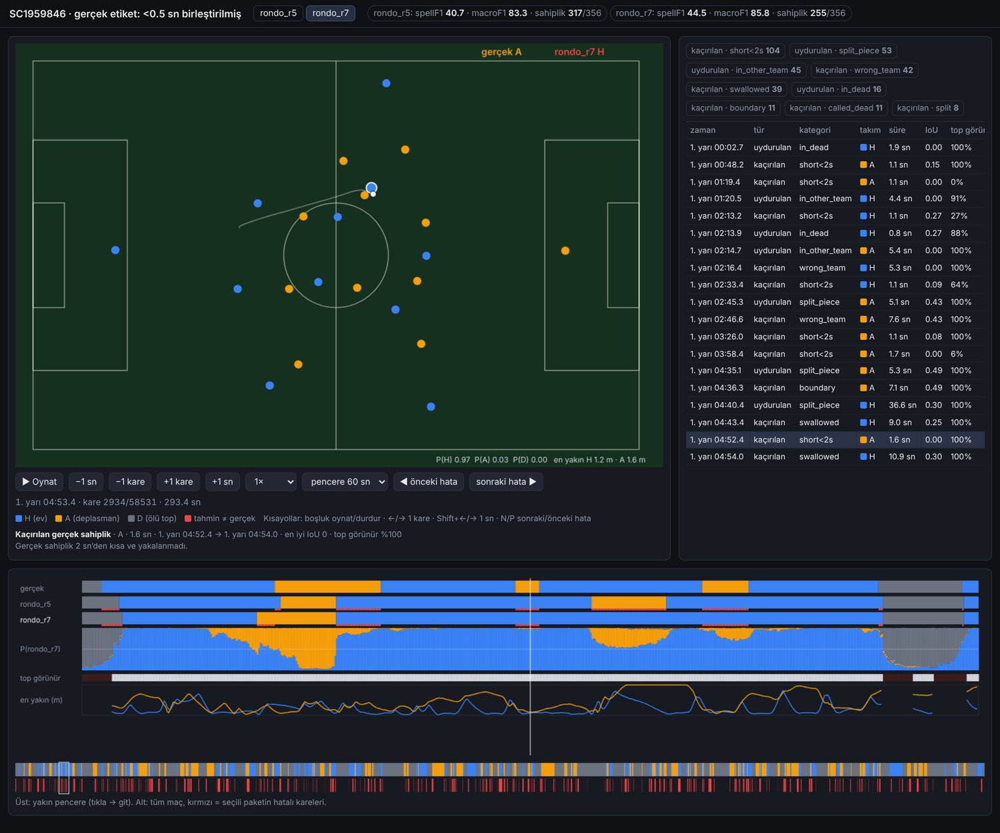

# rondolabs — who has the ball?

**Frame-level ball possession for Barcelona–Athletic · More Than a Hack 2027, Phase 1**

Team **rondolabs**: Can Çelikman (data scientist), Ahmet Can Karaoğlan (data scientist) and
Alicem Yurtever (football enthusiast).\
Code: [github.com/cancelikman/rondolabs-mtah2027](https://github.com/cancelikman/rondolabs-mtah2027)\
Submitted file: `rondolabs.csv`, 199,319 rows, SHA-256 `db1f4e975550534bdf16c1f35c47ae127d4e6d37be3d49a3cac3a69d6f21d14f`,
produced by the package `models/rondo_r10` (internally "F10"). F10 is F7 (`models/rondo_r8`, our
previous submission) with its graph network replaced by two networks that also learned from the
64-match PFF FC World Cup 2022 data, chosen by a five-provider evaluation (§5b).

---

## 1. The approach, and why

Our system labels each tactical-video frame from the provided automatic tracking only. We use the
positions of the 22 players and the ball at 25 frames per second. The labels are home possession
(`H`), away possession (`A`), dead ball (`D`), or not scored (`X`).

Early in the project we made one rule that shaped the whole design: **every choice is made on
labelled matches from other games, and every choice follows a rule written down before we see its
result.** The provided match carries no labels we may use, and the public five minutes are too
short and too calm to choose with. With 17 possessions, a single possession moves spellF1 by about
six points. So we built a pipeline that can be checked piece by piece on external data.

The pipeline has five stages. The first stage produces frame probabilities from **two learned
members**, mixed half and half. Each member combines two models:

- a gradient-boosted classifier, which reads 180 contact and geometry features per frame (ball–player
  distances, the nearest player of each team, ball speed, team shape, ball visibility);
- a temporal convolutional network, which reads the same kind of information over time. It outputs
  H/A/D probabilities, plus a second signal saying "a new possession starts here".

The *reference* member learned from five IDSSE matches (German professional football). The second member (*A3*)
learned from the same matches, the full Groningen match and six SkillCorner matches.

The second stage is a **multi-source correction model**. It looks at those probabilities together
with simple geometry and with what happens just before and just after each frame, and re-estimates
each frame. It was trained on two different data providers with equal weight, and it is mixed into
the probabilities at 70%.

The third stage, added on the final day, is a **set/graph network over the ball and every player**.
For each frame it describes every player relative to the ball: position, distance, velocity, speed
relative to the ball, and place on the pitch. It pools each team's players with attention, so the
order of the players does not matter. It then reads 21 such frames, 0.2 s apart (±2 s), with
dilated temporal convolutions. In F7 the network was trained from scratch on 10 SkillCorner and 5 IDSSE
matches, with random home/away swaps. In the submitted F10 it is the average of two such networks,
each trained on 15 SkillCorner matches, the 5 IDSSE matches and 56 PFF FC World Cup 2022 matches
(§3, §5b). Its H/A/D probabilities are mixed half and half with the output of the first two stages.

The fourth stage is a **directed Viterbi decoder**. It turns the frame probabilities into clean
possessions. Changing team carries a cost, so the decoder switches only when the evidence for the
other team is strong and lasts long enough. The fifth stage applies two **kick-off rules** taken
from the official tactical tags.

Two measurements on other games led to this design. **The first** was a hidden shortcut in the
German data: there the ball is frozen during every stoppage, so a model trained on it learns that
"a stationary ball means a dead ball". On providers that keep tracking the ball, that model's
dead-ball recall collapses from about 99% to between 4% and 58%. We therefore trained the second
member on views in which the frozen-ball trace is removed: the ball vanishes, is carried by the
restart taker, or rests at the restart spot.

**The second** was over-fitting to one source. A correction model trained only on SkillCorner data
gained about six points on SkillCorner but lost up to 29 points on other providers. Training the
same model on two providers with equal weight kept the gain and removed the loss. Since then we
accept a change only if it helps on held-out data **and** costs no more than one point on any of
our "guard" matches from other providers.

We did not use a single end-to-end network. With about twenty labelled external matches, a
per-frame model plus an explicit decoder was easier to inspect, easier to correct, and more stable
across providers.

## 2. Assets we used, and assets we dropped

The **tactical tracking** (ATD text and XML) is the only input to the models.

From the **Smart Tagging** file we use only the kick-off tags:

- From the start of each half until the first *Kick Off (Start)* tag, the label is dead ball.
- The 29 seconds before each *Kick Off (After Goal)* tag are also dead. That figure is the shortest
  goal-to-restart time we found over 16 goals in seven German matches, minus a five-second margin.

We also tried using the tagged phases ("Build Up", "Defending in Middle Third" and so on) as a soft
team prior. The errors in those phases turned out to be structural: whole phases sit on the wrong
team, and boundaries are seconds late. Under realistic errors of that kind, the prior gained nothing
on external data, so we dropped it.

The **homography** and the **broadcast feed** are not used. The **tactical video** is not used by the
pipeline, and we never compared predictions with it. The **public five-minute labels** are used to
check the pipeline: frame alignment, file format and what each label means.

Several other ideas were tested against fixed rules on external data and dropped, because none of
them passed:

- physical dead-ball rules and a self-supervised dead-ball model;
- set-piece windows and a restarting-team prior;
- minimum-possession and short-possession merging;
- lower team-switch costs and boundary shifts;
- a temporal network fine-tuned on SkillCorner;
- on the last day, "last-control memory" features and control-start evidence in the decoder (§5).

## 3. Training data

All labels come from other games. None come from the provided match.

| dataset | who produced the labels | amount | how we used it |
|---|---|---|---|
| **IDSSE** (Bassek et al. 2025, *Scientific Data* 12:195, CC BY 4.0) | official DFL/Sportec data provider (BallStatus, BallPossession) | 5 matches + 1 | training (all learned parts); J03WOY as a guard |
| **Groningen** WCSF_SolutionRoom (open) | provider alive and possession flags, 10 Hz resampled to 25 Hz | 1 match | training of the second member; second half also a guard |
| **SkillCorner Open Data** (MIT, A-League 2024/25, broadcast tracking) | SkillCorner's *automatic* possession groups and phases of play (not human labels; outside a phase = dead) | 20 matches | 10 for training (second member, correction model, graph network), 5 selection, 5 test (opened once) |
| **Metrica sample data**, games 1–2 (open) | Metrica event data, converted to labels by a definition written before scoring | 2 matches | guards |
| **PFF FC / Gradient, FIFA World Cup 2022** (released by PFF FC for research; access is requested from PFF FC, see [the release page](https://www.blog.fc.pff.com/blog/pff-fc-release-2022-world-cup-data); not redistributed here) | derived by us from PFF's event data (`rondo/pff_data.py`): the team of the last on-the-ball event holds possession; dead ball from an out-of-play, end-of-period or foul event until the restart kick | 64 matches (broadcast tracking, 29.97 fps, resampled to 25 Hz) | 56 for training the F10 graph networks; 8 held out (game id divisible by 8) for evaluation only |

**Label granularity.** Providers disagree on how quickly possession changes hands. EVALUATION.md
publishes how the official labels score against themselves when shifted by 3, 8 and 25 frames, and
that curve works as a fingerprint of how fine-grained the official labels are. We computed the same
curve for every candidate version of every external dataset and kept the closest version of each:

- IDSSE with reversals shorter than one second merged;
- SkillCorner with reversals shorter than half a second merged;
- Metrica, Groningen and PFF raw (PFF's distance to the official curve over its 64 matches is 0.035,
  next to SkillCorner's 0.026 and Groningen's 0.026; IDSSE 0.060, Metrica 0.14).

**PFF needed two corrections before training.** PFF stops tracking the ball in about 98% of
stoppage frames (91% of live frames are tracked), which would let a model learn "no ball means dead
ball"; we fill those gaps by interpolation. PFF also places the ball exactly on the carrier during
on-the-ball events (median 0.004 m at the start of an event); every PFF match is therefore used in
the target-like condition, whose ball drift removes that too-clean cue. Events and tracking share
one clock: the ball-to-carrier distance is minimal at zero offset in all 64 matches.

As a sanity check, the organiser's nearest-player baselines rank the same way on our SkillCorner
targets (0.066 / 0.208 / 0.250 / 0.224) as on the official match (0.049 / 0.200 / 0.243 / 0.224).

**Test conditions.** Each guard match is scored twice: clean, and *target-like*. Target-like adds a
smooth one-metre drift to the ball. That drift size is the one constant we derived from the provided
match, and it comes from an unlabelled statistic: the median distance between the ball and the
nearest player, 1.9 m. No labels were involved, which the rules allow.

## 4. The possession rules we implemented

**Loose balls, deflections and unresolved duels.** Possession stays with the team that last had it.
A switch needs evidence that lasts long enough to pay the decoder's team-switch cost, which a single
touch or deflection rarely does.

**New possession.** Possession changes where the temporal network's "new possession" signal and the
frame probabilities agree on the other team over consecutive frames. We impose no minimum duration
and no hard distance rule. Both were tested, and both hurt on external data.

**Restarts and stoppages.** A dead ball is its own state and always separates two possessions. Apart
from the two kick-off rules above, we model no restart-specific rule, because none passed external
validation. Frames outside the two halves are `X`.

## 5. What the results say

The table below shows spellF1 in percent, measured on matches the models did not learn from. F4 and
F6 are our earlier packages; F7 is F6 plus the graph network. The submitted F10 is F7 with that
network retrained on more varied data; it was chosen on the last evening (§5b).

| check | F4 | F6 | **F7** |
|---|---:|---:|---:|
| 2 held-out SkillCorner matches, opened once | 40.1 | 45.3 | |
| 5 SkillCorner matches never used before (selection) | 43.3 | 46.7 | **47.5**, better in 5 of 5 |
| 5 more SkillCorner matches, opened once (test) | 39.8 | 44.0 | **45.6**, better in 5 of 5 |

The ten newest SkillCorner matches had never been touched. F6 beat F4 on all ten of them, and F7 then
beat F6 on all ten as well.

To understand the remaining errors, we built a pitch replay with an error list
(`tools/viewer_html.py`) and an "error budget" (`tools/error_budget.py`). The error budget asks how
much spellF1 we would gain if one type of error were fixed perfectly.



The answer was clear. The largest losses come from **short possessions we miss** and from
**wrong-team calls while the ball is visible**:

- Making every frame without a ball correct would add only about five points.
- **89% of our wrong-team frames fall in loose or contested moments, when no player controls the
  ball.** There our error rate is 18%, against 5% when a player clearly has the ball.
- Possessions shorter than two seconds are almost never matched (1–8%), and even those over ten
  seconds only 69% of the time.
- Stoppages themselves are found well: over 93% of true stoppages longer than a second, fouls and
  offsides included.

Our model answers "who is nearest?" well and "who had control last?" less well.

**What we tried on the final day.** Each idea ran under a rule written down in advance
(`reports/rondo/r10_preregistration.md`): a gain of at least +1.5 on the five selection matches, and
no guard match losing more than one point.

- Refitting the correction model on more SkillCorner matches: +0.2.
- Adding "last-control memory" features: +0.5.
- Adding control-start evidence to the decoder: at most +0.3, on a training match.
- A learned possession-change detector: +0.1, with a guard loss of 1.4.

None of these passed, and none is used.

**The graph network** behaved differently from everything else. On the five selection matches it
gained +0.8 and won all five. On our guard matches it showed a clear pattern: it helps when the
tracking is noisy and hurts when it is clean.

| guard match | target-like (noisy) | clean |
|---|---:|---:|
| IDSSE WOY | +2.1 | −4.4 |
| Metrica 1 | +2.3 | −1.3 |
| Metrica 2 | +3.8 | −0.2 |
| Groningen H2 | −2.7 | −7.5 |

The competition tracking is automatic and noisy, so the team decided to accept the clean-tracking
losses. We wrote a new rule **after** seeing these numbers, and we record that openly: open the five
untouched test matches once, and switch only if F7 gains at least +1.5 on average and wins at least
four of the five. It gained **+1.6 and won all five** (+0.9 to +2.0 per match), so F7 replaced F6,
and it stayed our package until the last evening (§5b).

Was that gain a lucky random seed? We trained two more graph networks with exactly the same recipe
and different seeds. Over all ten matches they gained +1.1 and +1.0 over F6, against +1.2 for F7's
own network, so the gain does not depend on the seed. Averaging the three networks did not beat F7
on those matches (+0.9), so under its pre-registered rule the single network stayed.

**On the provided match** the public window serves as a pipeline check. With 17 possessions the 90%
interval is about ±13 points and the window is a calm phase of play, so it cannot rank models. Our
best estimate for the full match is the level we see on external data.


## 5b. The last evening: more data, and a better way to choose

On the final day we added the PFF FC World Cup 2022 data and tried fourteen changes, each under a
rule fixed before its result (rounds R14–R27; rule and result of each in `reports/rondo/`): more SkillCorner matches for the graph
network, PFF in five forms (one shared output, a separate PFF output, pre-training plus fine-tuning,
a camera-like view with off-screen players removed, averages of networks), a tracking-cleaning check,
and decoder and mixing settings. Each was judged as before, mainly on the ten newest SkillCorner
matches (N10) with the other providers as a floor, and **every one of them was rejected**.

Looking at all fourteen together showed a pattern we had not designed for. For every candidate, N10
and the guard matches from other providers disagreed in sign: the PFF networks lost 0.5–0.9 points on
N10 and gained 1–4 points on every other provider; a lower dead-ball prior did the opposite. N10 is
one league (A-League), one tracking provider and one automatic labeller. We had justified it as our
main proxy by similarity (broadcast tracking, label granularity) but never tested whether its
*ranking* of models agrees with anything else.

Watching tracking replays, of external matches and of the provided match as the rules allow, showed
how differently providers see a game: tracks that vanish and come back under a new identity,
players outside the camera, a ball that disappears in stoppages. We measured this on every source,
without labels: the competition match shows on average 19 of 22 players and the ball in 57% of
frames; SkillCorner 16 players and 60%; PFF, IDSSE, Groningen and Metrica all 22 players. No single
provider looks like the competition data in every respect, so no single provider should decide.
That is why we rebuilt the evaluation. It uses only labelled matches from other games.

**The new design (R28, written down before any R28 number).** Five families of labelled matches,
each with equal weight: SkillCorner (N10), IDSSE (WOY and WR9, the latter never used before),
Metrica (two games), Groningen (second half) and PFF (8 held-out matches; the PFF-trained candidates
were retrained without them). Before deciding, each family's ranking of the candidates is compared
with the average ranking of the other four (Spearman correlation); a family that disagrees with the
consensus (correlation below zero) is left out. A candidate is adopted if its mean gain over the
remaining families is at least +0.5 spellF1, it is ahead of F7 in most of them, and it loses no more
than one point in any. Ten candidates were scored: F7, four decoder/mixing settings and five network
variants.

| family | agreement with the other four (Spearman) |
|---|---:|
| IDSSE | +0.92 |
| PFF | +0.92 |
| Metrica | +0.88 |
| Groningen | +0.87 |
| SkillCorner (N10) | **−0.80**, left out |

| candidate (spellF1 change vs F7, points) | SkillCorner | IDSSE | Metrica | Groningen | PFF | mean of included |
|---|---:|---:|---:|---:|---:|---:|
| **F10: PFF networks, shared output** | −0.7 | +0.5 | +2.0 | +2.7 | +2.7 | **+1.95** |
| PFF networks, separate PFF output | −0.5 | +0.4 | +1.7 | +2.8 | +2.2 | +1.76 |
| PFF pre-training + SkillCorner/IDSSE fine-tuning | −0.2 | +0.2 | +1.1 | +1.9 | +2.0 | +1.32 |
| average of F7 + three network variants | −0.2 | −0.2 | +1.1 | +1.0 | +1.8 | +0.93 |
| lower dead-ball prior (decoder) | +0.6 | +0.1 | −0.4 | −0.1 | +2.0 | +0.39 |
| more SkillCorner matches only | −0.3 | −0.3 | +0.2 | +1.1 | +0.1 | +0.27 |
| three other decoder/mixing settings | +0.1 to +1.0 | −3.3 to 0.0 | −1.5 to −0.1 | −2.4 to +0.1 | −1.2 to +0.6 | −2.1 to +0.2 |

Four providers rank the candidates almost identically; only the A-League SkillCorner set ranks them
the other way. The chosen network wins in all four included families. Because the PFF family could
favour PFF-trained networks (same tournament, although different matches), we also checked the
choice without it, after the fact: the mean over IDSSE, Metrica and Groningen is +1.7, so the
decision does not rest on PFF alone.

**What we give up.** On the A-League SkillCorner matches F10 is 0.7 points below F7, consistently.
If the competition match behaves like those matches rather than like the four other providers, F10
loses a little.

**What we take from the last day.** The experiment design mattered as much as the model
architecture. A good model judged by a narrow yardstick looked worse than it was, and the same
fourteen ideas read very differently once five providers judged them together. More data, and above
all more *varied* data, gave us a model we trust more: the World Cup matches improved the network on
every provider except the one league we had been leaning on.

## 6. Limitations, and what we would do next

Our biggest weakness is the **short, contested possession**: a quick interception or a one-touch
pass. The next step would be a dedicated boundary model that predicts touches, controlled receptions
and pass releases, used as transition evidence in the decoder. A duration-aware (semi-Markov)
decoder would be the step after that.

**Our model selection rests on external proxies that disagree.** Four providers favour F10, the
A-League SkillCorner set favours F7 (§5b). We followed the four, by a rule fixed before scoring, but
the choice of that rule came late on the last day, after the disagreement had been seen.

**The dead ball is only partly validated.** No labelled external data tracks the ball through
stoppages the way the competition tracking does, so we could not test dead-ball improvements on
realistic data.

**Label definitions still differ between providers.** SkillCorner's labels are automatic, and the
German labels change possession on every touch. The granularity fingerprint narrows this gap, but it
does not close it.

Finally, **more labelled data from more providers** is what moved the model most, and judging every
change on several providers at once is what we would do from the first day next time.

## 7. Reproduction

```
python -m venv .venv
.venv\Scripts\python -m pip install -r requirements-tcn.txt
.venv\Scripts\python -m rondo.predict --package models/rondo_r10 --data <organiser data folder> --out rondolabs.csv
.venv\Scripts\python evaluation/validate_submission.py rondolabs.csv
```

**Environment.** The run uses only the CPU, with two threads and deterministic torch. It needs
Python 3.13 and the pinned dependencies, and it was tested on Windows.

**Data folder.** It is the organiser bundle with `tactical/BAR-ATH_tactical_atd.txt`, `.xml` and
`_smart_tagging.xml`.

**Integrity.** Model weights are checked against the SHA-256 values in
`models/rondo_r10/manifest.json` before use. The script prints only the output path and its hash.

**Training and error analysis.** The training code of the final components is in `rondo/`
(`train_c3.py`, `train_a3.py`, `twin.py`, `gnn.py`, `r12.py`; for F10 `pff_data.py`, `r15.py` and
`r28.py`) and `src/`. Re-training needs the external datasets in §3; the PFF data must be obtained from
PFF FC (https://www.blog.fc.pff.com/blog/pff-fc-release-2022-world-cup-data) and is read from a folder outside the repository (`RONDO_PFF_DIR`).
Regenerating the submission file does not need it: the trained weights are in `models/rondo_r10`.
The error tools in `tools/` run on open labelled matches.
